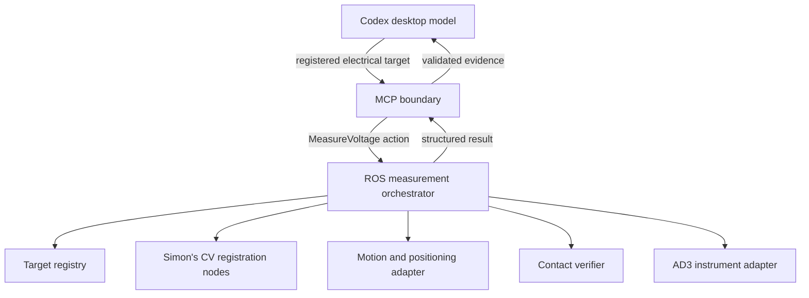

# MCP and ROS ownership

The desktop host supplies the reasoning model. It chooses an electrical target,
asks for a complete measurement, and explains the evidence. The MCP process doesn't
call another model.

MCP validates input, dispatches goals, forwards stage feedback, handles outer timeout
and cancellation, checks the final evidence, and records request IDs. It never
looks up coordinates, queries TF, runs IK, chooses recovery movements, or reads AD3.

The orchestrator owns precheck -> resolve -> plan -> approach -> position check ->
contact check -> acquire -> retract. It validates registration throughout the action,
holds the probe during acquisition, serializes the whole bench, and owns stage
deadlines and physical stopping. It must also reject concurrent goals from other
clients. The MCP busy guard alone doesn't enforce bench-wide exclusivity.

Simon owns CV/registration implementation. This repository supplies its interface
source only. Board-edge fitting is his proposed method; there's no AprilTag dependency.
A valid camera overlay doesn't establish robot accuracy or electrical contact.

Only the explicit stub backend runs a scripted simulated sequence inside this
Python process. That sequence tests the boundary; it isn't the production stage machine.

## Evidence contract

Successful voltage results require finite volts, matching request/target identity,
verified contact, completed movement, correct positioning, unchanged board,
valid calibration/registration, confirmed retraction, and confirmed stopping.

The shared action adds request ID echo, calibration validity, registration ID,
retraction status, and final stop confirmation to Simon's draft. These additions
make checks independent and cancellation outcomes explicit. Both ROS sides must
build the same interface package.

Non-success ROS readings are NaN; MCP outputs null. Infinity, a numeric reading on
a failed result, missing mode, contradictory stage checks, or an action-state/result
mismatch produce a protocol violation. Valid 0 V with verified checks remains 0 V.

No physical result means mode is null, rather than guessed from MCP configuration.
Only the orchestrator can assert live or simulated mode.

## Cancellation and uncertainty

rclpy spins in a background MultiThreadedExecutor. Its futures are bridged to the
MCP asyncio loop with thread-safe callbacks. No blocking spin runs in an MCP handler.
Goal acceptance is asynchronous; a cancel intent is retained for a goal accepted late.

The ROS orchestrator handles actual stop and any safe retraction. A cancellation
acknowledgement alone isn't a stop confirmation. If a final trustworthy result
can't be obtained within the configured grace, MCP records execution uncertainty
and blocks new measurements. Timeouts never retry or home an arm.

An SQLite journal records dispatch before sending a goal. An unfinished or uncertain
record blocks later dispatch across MCP restarts. Saved exact request IDs return the
same result, and changed targets are rejected. There is no automatic reset interface.

## AD3 and future voice

Voltage is the first complete task contract. The AD3 capture tools are the exception
to "MCP never touches hardware": they run the WaveForms SDK in this process on the Windows
host and turn each arm's tool turret through its arm server ([docs/AD3.md](docs/AD3.md)).
They don't position the probe or verify contact, so their results never claim contact.
The wavegen, power supplies, and DIO outputs stay off. read_digital is not_implemented.

A future voice client can transcribe speech, call the same MCP tools, and speak the
reply. Audio-provider dependencies don't belong in the measurement executor.
