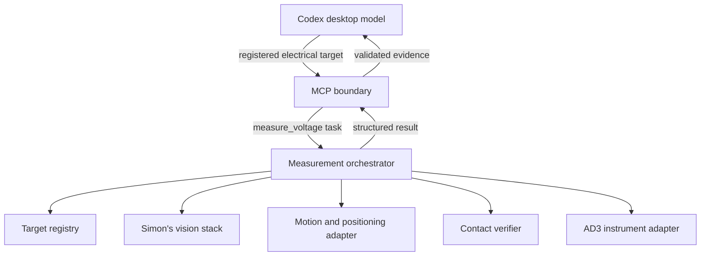

# MCP and orchestrator ownership

The desktop host supplies the reasoning model. It chooses an electrical target,
asks for a complete measurement, and explains the evidence. The MCP process doesn't
call another model.

MCP validates input, dispatches goals, forwards stage feedback, handles outer timeout
and cancellation, checks the final evidence, and records request IDs. It never
looks up coordinates, transforms frames, runs IK, chooses recovery movements, or reads AD3.

The orchestrator owns precheck -> resolve -> wrist homing -> plan -> approach -> position check ->
contact check -> acquire -> retract. It validates registration throughout the action,
holds the probe during acquisition, serializes the whole bench, and owns stage
deadlines and physical stopping. It must also reject concurrent goals from other
clients. The MCP busy guard alone doesn't enforce bench-wide exclusivity.

The [vision service](vision/README.md) defaults to wrist-camera homing for each pad:
settled observation -> guarded lateral move -> settled observation -> joint board-pose
fit and triangulation check. Measured joints and calibrated hand-eye geometry define
camera movement; requested movement isn't a measured baseline. The resulting revision
is scoped to that arm and target. Fresh wrist observations confirm it during alignment;
movement, calibration changes and expiry require another homing stage.

The fixed depth-capable camera supplies optional RGB overview only. No fixed-camera
PnP, depth, bench-plane calibration or fixed-camera extrinsic is required in that
path. An observed overview change can invalidate wrist homing, never establish a pose.
[registration/](registration/README.md) remains the standalone legacy fixed-camera
board-edge library, enabled in VisionService only with explicit registration_source=fixed.
[arm/](arm/README.md) describes the Maker Arms with the rotating toolhead.
The orchestrator still owns motion and IK; vision only measures and corrects.
A valid camera overlay or alignment doesn't establish electrical contact.

Only the explicit stub backend runs a scripted simulated sequence inside this
Python process. That sequence tests the boundary; it isn't the production stage machine.

## Evidence contract

Successful voltage results require finite volts, matching request/target identity,
verified contact, completed movement, correct positioning, unchanged board,
valid calibration/registration, confirmed retraction, and confirmed stopping.

The result carries request ID echo, calibration validity, registration ID,
retraction status, and final stop confirmation. These make checks independent and
cancellation outcomes explicit.

Non-success orchestrator readings are NaN; MCP outputs null. Infinity, a numeric reading on
a failed result, missing mode, contradictory stage checks, or an action-state/result
mismatch produce a protocol violation. Valid 0 V with verified checks remains 0 V.

No physical result means mode is null, rather than guessed from MCP configuration.
Only the orchestrator can assert live or simulated mode.

## Cancellation and uncertainty

A backend's `start()` must not block an MCP handler. It returns a handle whose result
and cancel are awaited on the MCP asyncio loop. If goal acceptance is asynchronous,
the handle must retain a cancel intent for a goal accepted late.

The orchestrator handles actual stop and any safe retraction. A cancellation
acknowledgement alone isn't a stop confirmation. If a final trustworthy result
can't be obtained within the configured grace, MCP records execution uncertainty
and blocks new measurements. Timeouts never retry or home an arm.

An SQLite journal records dispatch before sending a goal. An unfinished or uncertain
record blocks later dispatch across MCP restarts. Saved exact request IDs return the
same result, and changed targets are rejected. There is no automatic reset interface.

## AD3 and future voice

Voltage is the first complete task contract. The AD3 capture tools are the exception
to "MCP never touches hardware": they run the WaveForms SDK in this process on the Windows
host and turn each arm's tool turret through its arm server ([docs/AD3.md](docs/AD3.md)).
They don't position the probe or verify contact, so their results never claim contact.
The wavegen, power supplies, and DIO outputs stay off. read_digital is not_implemented.

A future voice client can transcribe speech, call the same MCP tools, and speak the
reply. Audio-provider dependencies don't belong in the measurement executor.

## Design knowledge

The design tools ([docs/DESIGN_TOOLS.md](docs/DESIGN_TOOLS.md)) read KiCad files and
datasheets in this process. They hold board-frame geometry straight from the PCB file,
which is the same data vision loads, and rank probe pads by clearance. They still don't
transform into camera or arm frames. `locate_on_image` asks the orchestrator, and vision
does the projection. A pad ranking is not a registered target, and a predicted pixel
is not a position check: `measure_voltage` still goes through the orchestrator's
registry and stage checks.
