# Pinpoint

**An MCP server and a robot bench that let an AI agent measure a real circuit.**

LLMs can write firmware and help design a board, but when the board misbehaves a human still has to
pick up the probes. Pinpoint closes that gap. The agent names a pad or a net; a robot arm finds it
on the real board, puts a needle on it, and the bench's instruments (logic analyzer, oscilloscope,
multimeter, thermal camera) read it back. Every result says what was measured, where, and whether
the contact can be trusted, so an agent can reason about it instead of guessing.

Built at [Cal Hacks 13.0](https://devpost.com/software/probe-mcp) by William Chenyin, Jay Wen,
Shenghua Jin and Matthew Lin. The repository, Python package and Claude Code plugin are named
`hardware-troubleshooter`.

[](https://youtu.be/0YZz3dWozMk)

<p align="center">
  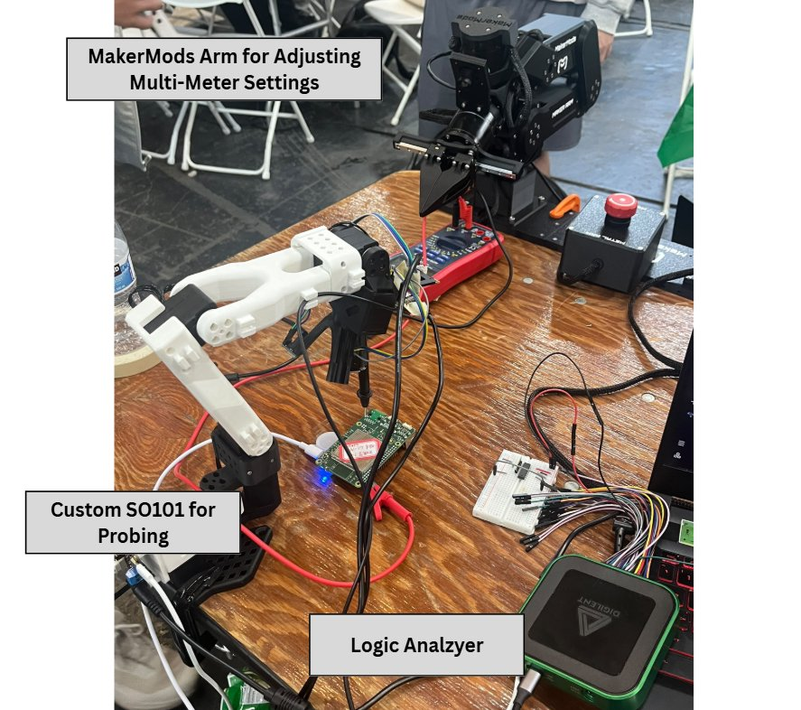
</p>

- [How a probe works](#how-a-probe-works)
- [The rig](#the-rig)
- [How it sees the board](#how-it-sees-the-board)
- [Tools](#tools)
- [Trusting a reading](#trusting-a-reading)
- [Quick start](#quick-start)
- [Repository map](#repository-map)
- [Status and what's next](#status-and-whats-next)

## How a probe works

The agent says "probe tx". One tool call, `probe_pin`, does the rest. Code plans every motion; the
model never invents coordinates. Anything missing (which board, which pin, arm disarmed, AD3
absent) comes back as one `needs_input` question **before** anything moves.

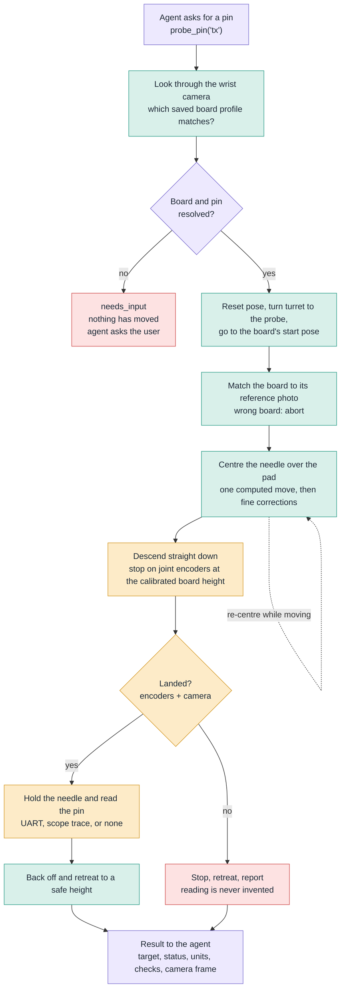

Purple is the software layer, green is vision and motion, amber is contact and measurement, red is a
stop. Landing is judged by the joint encoders and the camera, which is not electrical contact
evidence, so capture results always say `contact_verified: false`.

### The agent's debugging loop

The repository is also a Claude Code plugin. Its skills ([`pcb-debug`](skills/pcb-debug/SKILL.md),
[`embedded-debug`](skills/embedded-debug/SKILL.md), [`new-board-setup`](skills/new-board-setup/SKILL.md))
teach the agent to work from evidence in power-tree order.

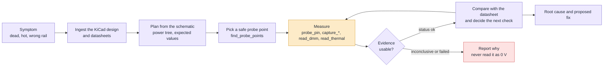

## The rig

<table>
  <tr>
    <td width="50%">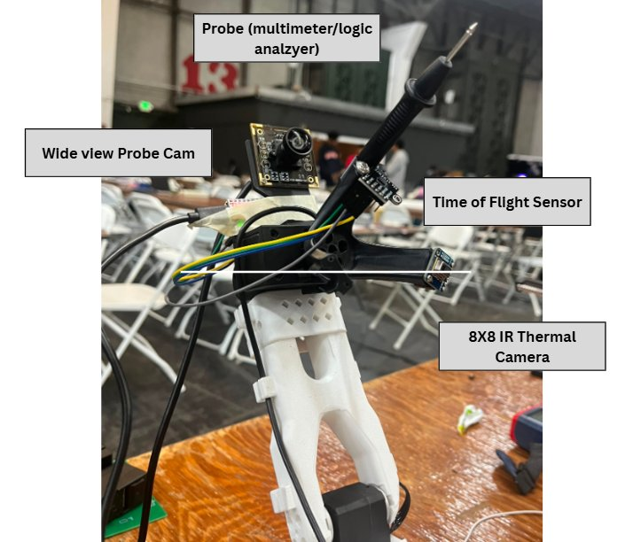</td>
    <td width="50%">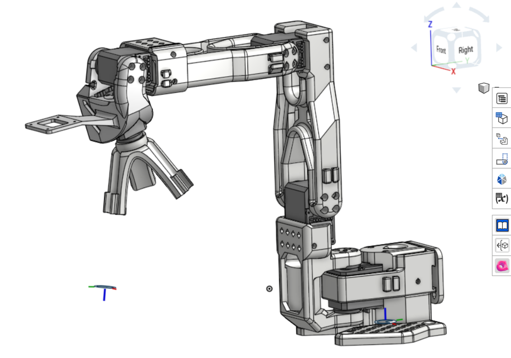</td>
  </tr>
  <tr>
    <td><sub>The custom end effector on an SO101 arm.</sub></td>
    <td><sub>Onshape assembly: the end effector is a turret that swaps heads.</sub></td>
  </tr>
</table>

| Part | What it is |
| --- | --- |
| Probe arm | An SO101 arm with a custom rotating-turret end effector. Slot 3 holds the one needle probe, used as the scope, logic and multimeter head. Slot 2 holds the thermal camera. Slot 1 is empty. |
| Wrist camera | A wide-view camera on the wrist. It finds the board and the pad, and closes the loop on the needle. |
| Sensor head | An ESP32-S3 with a VL53L0X time-of-flight sensor and an AMG8833 8x8 IR thermal camera ([firmware](firmware/amg8833_usb/README.md)). |
| Instruments | An Analog Discovery 3 through the WaveForms SDK: scope trace and logic capture with UART, I2C, SPI and PWM decoding. |
| Multimeter arm | A MakerMods Maker Arm that turns a multimeter's knob and looks at its display ([arm/bench](arm/bench/README.md)). |
| Host | A Windows machine runs the MCP server, the AD3 SDK and the arm servers. No ROS. |

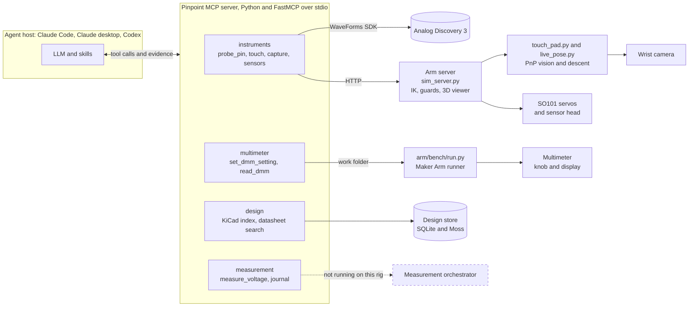

The arm server also serves a browser digital twin: the arm's URDF, live encoder angles, IK, the
probe height and a pad picker. Press **G** to arm the real arm, **Space** to stop it.

<p align="center">
  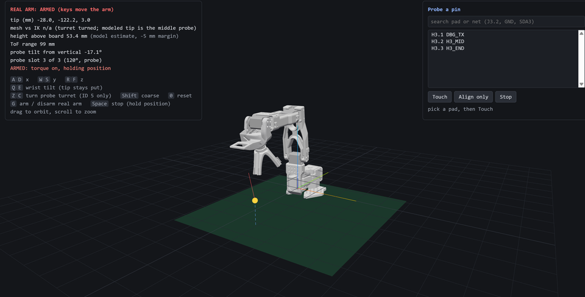
</p>

## How it sees the board

An external camera was hard to calibrate and didn't generalize across boards. Pinpoint uses a single
camera on the wrist, solves the board's pose with PnP, and lets code plan the motion. The board is
matched against its **silkscreen** and the KiCad reference rather than colour, because colour
segmentation broke on glare and wood grain.

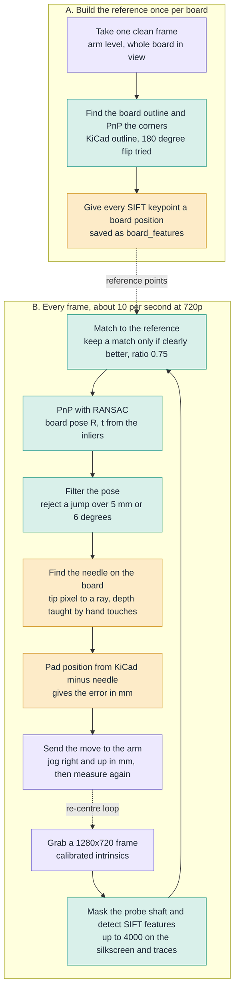

<table>
  <tr>
    <td width="30%">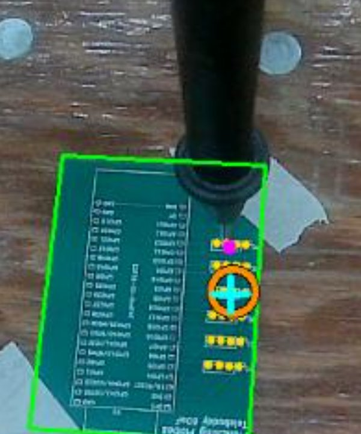</td>
    <td>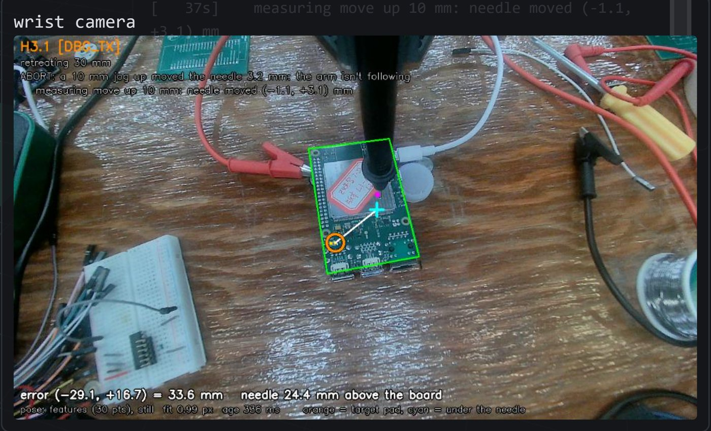</td>
  </tr>
  <tr>
    <td><sub>Pink is the needle, cyan is the projected pad.</sub></td>
    <td><sub>The live overlay on a Quectel Pi M1. Orange is the target pad, cyan is under the needle. Here a guard has aborted the run because a 10 mm jog moved the needle only 3.2 mm.</sub></td>
  </tr>
</table>

Hard-won details, so nobody has to find them again:

- **Height.** The camera read the needle's height as zero while it still hovered above the board.
  The final descent goes straight down and stops on the joint encoders at a board height calibrated by
  one hand-guided touch (`calibrate_board.py`). The time-of-flight sensor sees beside the needle and
  is only a start-pose check, not a contact sensor.
- **Servos.** Stiction stops them 1 to 3 mm short of a small move, then they jump, and they sag under
  load. So: one large computed move, then a few fine corrections, with a filtered pose so the overlay
  stops shaking. Don't change servo gains without testing on one joint first; P 40 / I 4 made the arm
  vibrate violently.
- **Line-up** comes from a measured 2x2 jog response (one 10 mm move per jog axis, then Broyden
  updates), not a single rotation.
- **Calibration** is per arm and per board. The needle depth was off by about 26 mm until it was
  calibrated by touching known pads.

The tuned setup for each board is saved in [`boards/<name>/`](boards/quectel-pi-m1/README.md). On the
Quectel Pi M1 it touched `DBG_TX` four times in a row, landing 0.43 to 1.31 mm from the pin centre.
[`new-board-setup`](skills/new-board-setup/SKILL.md) walks through making a profile for a new board.

### Thermal and multimeter

<table>
  <tr>
    <td width="50%">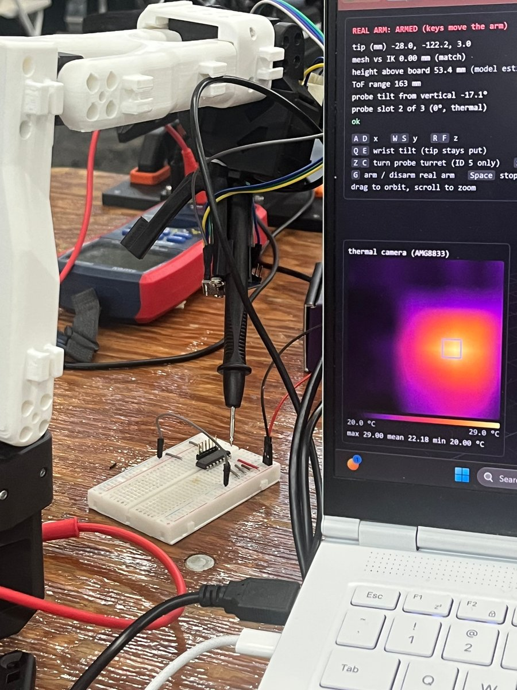</td>
    <td width="50%">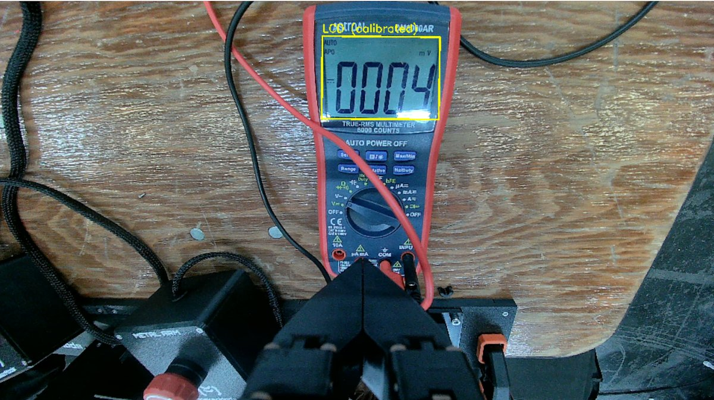</td>
  </tr>
  <tr>
    <td><sub>The turret swings to the thermal camera. This IC had Vin and GND swapped and showed it as a hot spot.</sub></td>
    <td><sub>The bench arm lifts to its camera pose and reads the 7-segment LCD locally.</sub></td>
  </tr>
</table>

<p align="center">
  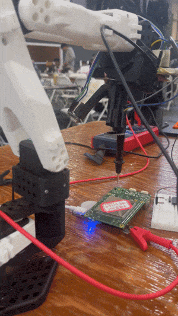
</p>

## Tools

The agent sees these through MCP. Annotations mark which ones move hardware.

| Group | Tool | What it does |
| --- | --- | --- |
| **Probe a board** | `probe_pin(target, ...)` | The one entry point for "probe tx": identify the board, resolve the pin, touch, read while holding. |
| | `look_at_bench(arm)` | Wrist camera frame, each saved board's reference photo, and which profile matches. |
| | `list_boards(arm)`, `select_board(arm, board)` | List the tuned board profiles and their nets; load one. |
| | `touch_pad(arm, target)`, `get_touch`, `stop_touch` | Move onto a pad and hold, follow a running touch, abort and retreat. |
| | `set_armed(arm, on)` | Arm or disarm the real arm. It starts disarmed and refuses every move. |
| **Instruments** | `get_instrument_status()`, `list_capture_profiles()` | AD3 connection, each arm's tool head, wiring, and the named scope profiles and logic types. |
| | `select_tool(arm, head)` | Turn the turret to the scope, logic, dmm or thermal head. |
| | `capture_waveform(arm, profile_id)` | Scope trace: Vpp, min/max, mean, RMS, frequency, duty. |
| | `capture_logic(logic_type, lines)` | Capture and decode UART, PWM, I2C, or partial SPI. |
| | `read_tof(arm)`, `read_thermal(arm)` | ToF range and tip height; AMG8833 8x8 grid in °C with the hottest cell. |
| **Multimeter** | `list_dmm_settings()`, `set_dmm_setting(setting)` | Turn the rotary switch with the bench arm, then return home. |
| | `read_dmm()` | Lift to view the meter and decode the display (value, unit, LCD image). |
| **Design and datasheets** | `ingest_design`, `list_designs`, `set_active_design` | Index a KiCad board and its schematics. |
| | `query_design`, `find_probe_points`, `locate_on_image` | Exact net and pad lookup, ranked safe landing points, and where a pad appears in an image. |
| | `ingest_datasheet`, `search_datasheets`, `list_documents`, `record_pinout` | Datasheet search by meaning and keyword (Moss, with a local SQLite fallback), and recorded pin tables. |
| **Orchestrator** | `measure_voltage`, `list_test_points`, `get_rig_status`, `abort`, `get_operation` | The registered-target measurement contract. No orchestrator runs on this rig yet; see [status](#status-and-whats-next). |
| | `read_digital(group_id)` | Declared extension point. Returns `not_implemented`. |

Deeper docs: [AD3 wiring and outcomes](docs/AD3.md), [design tools and the plugin](docs/DESIGN_TOOLS.md),
[the measurement contract](docs/MEASUREMENT_CONTRACT.md), [two arms on one bench](docs/WORKCELL.md).

<details>
<summary>Multimeter tools: configuration and behaviour</summary>

The knob tools drive [arm/bench/run.py](arm/bench/README.md) through its work folder, so the runner
must be running (torque on, arm parked at home or above the meter) on this host. Both moving tools
end with the arm back at home: held up above the meter, J2 and J3 carry its weight and overheat (on
2026-10-25, 20 minutes there tripped J3). They need `TH_DMM_KNOB_CONFIG`, or a `config/dmm_knob.json`
(see [config/dmm_knob.example.json](config/dmm_knob.example.json)), which maps setting names to taught
knob poses. A turn starts from the last recorded setting unless the call passes `current_setting`.
After a failure once the arm has moved, the knob position is recorded as unknown, so the next call
needs `current_setting`. A turn can't see the knob, so `setting_verified` is always false.

`read_dmm` needs the config's `display` section and the `dmm` extra (OpenCV). It lifts the arm from
home to its camera pose above the meter, decodes the 7-segment LCD locally in several frames, using
the calibrated layout in [arm/bench/display/](arm/bench/display/dm6000ar.json), and returns home
(about 15 s in all, a few seconds of it up above). Only a reading most frames agree on is
`status=ok`; a wandering value is `inconclusive: unstable_reading`. Glare is never read as an unlit
segment: a digit decodes only if every possibility agrees, and a decimal point hidden by glare is
placed from the unit's fixed range (`decimal_inferred`). `setting_check` compares the unit with the
recorded knob setting. Frames come from the camera, or from a file a live viewer keeps rewriting
(`frame_file`), since Windows lets only one program hold the camera.

</details>

## Trusting a reading

A number needs context. The agent has to know which point the bench tested, whether contact was
valid, and whether the operation finished, so that context is part of every result.

- Only `status=ok` with a non-null reading is evidence. **Inconclusive contact is not 0 V.** A real
  0 V comes only with verified checks.
- Each measurement returns status, nullable reading, units, requested and resolved target, contact and
  stage checks, failure reason, request ID, mode, duration and registration ID. An invalid result
  becomes `inconclusive: protocol_violation`.
- `mode` is `live` or `simulated`, and comes from the thing that took the reading. A missing backend
  never activates the simulator, and simulated readings demonstrate software only.
- An optional `request_id` makes an exact retry return the saved result, and reusing it for another
  target is rejected. Without it every call is a new request, so a host mustn't silently retry an
  interrupted movement.
- An SQLite journal records dispatch before the goal is sent. After a timeout or lost connection the
  operation is latched as uncertain and **blocks the next measurement** until someone inspects the
  bench. No MCP tool can dismiss it, and restarting the process isn't a motion reset.
- Capture tools read wherever the probe already is and never claim contact. A flat line or
  `no_activity` can mean the probe is touching nothing.
- Stop on uncertain motion, timeout, abort, protocol violation or failed calibration, and never retry
  a movement silently.

The orchestrator contract, stage by stage, is in [ARCHITECTURE.md](ARCHITECTURE.md) and
[docs/MEASUREMENT_CONTRACT.md](docs/MEASUREMENT_CONTRACT.md).

## Quick start

### 1. Try it with no hardware

Install [uv](https://docs.astral.sh/uv/), then clone and run the one-shot MCP test:

```powershell
git clone https://github.com/mutms7/hardware-troubleshooter.git
cd hardware-troubleshooter
uv sync --frozen --extra dev
uv run hardware-troubleshooter smoke
```

It starts a real MCP server, performs the handshake, lists targets, measures the synthetic point,
prints the result and exits. Expect `status=ok`, `reading=3.29`, `units=V`, `mode=simulated`. Each
smoke run uses a fresh temporary simulated rig and journal.

```powershell
uv run hardware-troubleshooter smoke --scenario contact_failed
```

That one expects `status=inconclusive`, `reading=null`, `failure_reason=contact_unverified`. Other
smoke scenarios are `board_moved` and `stage_timeout`. To leave a server running for a desktop client
instead:

```powershell
uv run hardware-troubleshooter mcp --backend stub --scenario success
```

The process waits for an MCP client and isn't an interactive terminal. Synthetic targets are
`TP_DEMO` and `DEMO_RAIL`; neither describes a real circuit. Scenarios: success, contact_failed,
zero_unverified, board_moved, stage_timeout, slow, stale_calibration, unset_config, malformed,
bad_mode, unavailable, cancel_unconfirmed, lost_connection, bad_position.

To simulate the instruments too, set `TH_INSTRUMENTS=fake` and `TH_RIG_CONFIG=config\rig.example.json`
(see [docs/AD3.md](docs/AD3.md#software-simulator)). Run the arm server with no `--hardware` flag for
a simulated arm and the browser viewer at <http://localhost:8765>.

### 2. Connect an agent

**Claude Code** (bundles the server and the debugging skills):

```text
/plugin install hardware-troubleshooter --marketplace mutms7/hardware-troubleshooter
```

For local development use `claude --plugin-dir .` from the repository root.

**Codex desktop or another stdio host:** add a local MCP server whose command is this checkout's
`.venv/Scripts/python.exe` and whose argument is the absolute path to `run_mcp.py`. Set
`TH_BACKEND=stub` for the simulator. [config/codex-mcp.example.toml](config/codex-mcp.example.toml)
has a portable example; replace its paths before merging it into a host configuration.

Hosts keep running the server code they started with and some ignore the server's instructions. After
changing code, restart the host. Routing guidance lives in tool descriptions and result fields
(`note`, `next`, `ask_user`) for the same reason.

### 3. Run on the real rig

1. Install Digilent WaveForms (it provides `dwf.dll`) and close its app, since only one process can
   own the AD3. Check it with
   `.\.venv\Scripts\python.exe -m troubleshooter.cli ad3-check`. Read the
   [ground precautions](docs/AD3.md#ground-precautions) before clipping a ground lead.
2. Start the arm server, one per arm: `python sim_server.py --hardware COM10 --sensors COM5 --arm A`
   (or `.\start_server.ps1`). Open the viewer, then press **G** to arm.
3. Copy [config/rig.example.json](config/rig.example.json) to `config/rig.json`, fix the arm URLs and
   the wiring, and set `TH_RIG_CONFIG`.
4. For the multimeter, start `arm/bench/run.py` ([setup](arm/bench/README.md)) and set
   `TH_DMM_KNOB_CONFIG`.
5. Optional: `MOSS_PROJECT_ID` and `MOSS_PROJECT_KEY` for datasheet search (datasheet text and
   component summaries are uploaded to Moss; local SQLite stays the source of record).
   `TH_DESIGN_DIR` moves the stores, by default `%LOCALAPPDATA%\hardware-troubleshooter`, which keeps
   SQLite off OneDrive.

Local `.env` files are ignored. Configuration comes from the environment or CLI flags, and no
model-provider keys are needed.

## Repository map

| Path | What's there |
| --- | --- |
| [`src/troubleshooter/`](src/troubleshooter) | The MCP server: tools, measurement contract and journal, instrument and design services, DMM knob and display reader. |
| [`sim_server.py`](sim_server.py), [`viewer/`](viewer) | Arm server: IK, safety limits, collision checks, HTTP API and the browser digital twin. |
| [`touch_pad.py`](touch_pad.py), [`live_pose.py`](live_pose.py), [`pcb_pnp.py`](pcb_pnp.py) | The touch flow that runs on the bench: PnP pose, needle tracking, descent. |
| [`boards/`](boards) | Tuned per-board profiles: pad geometry, silkscreen features, start pose, board height. |
| [`arm/`](arm/README.md), [`arm/bench/`](arm/bench/README.md) | Maker Arm URDF and SDK profile with the rotating toolhead; hand-taught moves for the multimeter. |
| [`vision/`](vision/README.md), [`registration/`](registration/README.md) | Wrist-camera two-view homing and pad alignment library; the legacy fixed-camera board-edge library. Both are tested on synthetic frames. |
| [`skills/`](skills), [`.claude-plugin/`](.claude-plugin) | The Claude Code plugin and its debugging skills. |
| [`firmware/amg8833_usb/`](firmware/amg8833_usb/README.md) | ESP32-S3 sensor head firmware (ToF and thermal). |
| [`docs/`](docs) | AD3, design tools, measurement contract, workcell, handoff notes. |
| [`config/`](config) | Example rig, workcell, DMM knob and Codex configuration. |
| [`tests/`](tests) | The MCP, instrument, design and DMM test suite. |

## Verify

```powershell
uv run pytest -q
uv run ruff check .
uv run ruff format --check .
```

Tests start a real MCP subprocess and exercise success, failed contact, unknown target, moved board,
stale calibration, malformed results, timeout, explicit abort, MCP request cancellation, busy
rejection, replay protection and persistence after uncertain execution. The registration library
needs numpy, OpenCV and PyYAML: `python -m pytest -q registration/test`. Run `arm/test` and
`vision/test` the same way, each folder on its own. `arm/bench/sim_check.py` runs the multimeter
runner against simulated motors.

Passing tests here doesn't prove a physical measurement.

## Status and what's next

| | State |
| --- | --- |
| **Working on the rig** | Touching a named pad on a tuned board from the wrist camera alone. AD3 scope and logic capture. ToF and thermal reads. Turning the multimeter's knob and reading its display. The digital twin viewer. |
| **Simulated or synthetic only** | The `measure_voltage` task path (stub backend), the fixed-camera registration library, and the two-view homing library in `vision/`. |
| **Not built yet** | The measurement orchestrator, electrical contact verification, `read_digital`, bottom-side probing, and a second probe arm on the real bench. |

The registry needs the real circuit's points, reference wiring and allowed operating conditions, and
those values remain unset. Jev, TypeSafe, RoboTwin and Cartesia aren't active dependencies or
execution paths; voice could later be a separate client of the same tools. Simon's
[handoff](docs/SIMON_HANDOFF.md) covers the CV coordination.

**Next.** A robotic arm turned out not to be the best form factor. We envision a motorized spider pin
tool, the kind used for data recovery, and the end goal is an autonomous debugger that finds the root
cause of a failing device and proposes the fix.

## Credits

Pinpoint was built at Cal Hacks 13.0 by William Chenyin, Jay Wen, Shenghua Jin and Matthew Lin.
See the [Devpost page](https://devpost.com/software/probe-mcp) for the story. The Maker Arm URDF is
vendored (Apache-2.0) from [maker-arm-sdk](arm/vendor/maker_arm/UPSTREAM.md). Built with Python, FastMCP, Pydantic,
NumPy, OpenCV, ikpy and SQLite.
