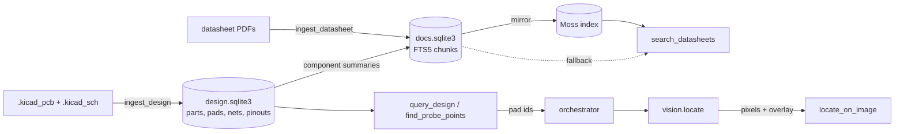

# Design tools, datasheets and the plugin

The MCP server reads the board's KiCad files, ranks safe places to land a probe, asks
vision where those pads appear in a camera image, and searches datasheets. The design and
datasheet tools need no rig. The repository is also a Claude Code plugin that bundles the
server with two skills.



## Where data comes from

| Data | Source | Never from |
| --- | --- | --- |
| Pad geometry, nets, pin functions | `.kicad_pcb`, via the design store | images, datasheet text |
| MPN, datasheet URL, description | schematic fields merged by reference, else board fields | |
| Pin names and limits | `record_pinout`, which the model writes after reading a cited datasheet page | |
| Where a pad appears in an image | vision, through the orchestrator | the MCP process |

Pad ids match `vision.pads`: `<reference>.<pad number>` (R1.2). An untented via is
`VIA<n>`, numbering every via in file order. Both sides parse the same file, so
`find_probe_points` and `locate_on_image` agree on names. Only copper reachable from the top
is kept. Bottom-side probing isn't supported.

## Choosing a probe point

`find_probe_points` scores each pad on the net that has a solder-mask opening:

- **Short margin**: distance from the pad centre to the nearest exposed copper on another
  net, minus the tip radius and the position uncertainty. Below zero, the candidate is
  refused (`short_risk:<pad>`). Copper under solder mask doesn't count, because the tip
  can't short through mask.
- **Landing margin**: the pad's inscribed radius minus the uncertainty. Below zero gives
  `may_miss_pad`. It isn't refused, since a miss only fails the contact check.
- **Order**: unrefused first, then test points, passives, vias and connectors, then IC pins,
  then wider margins.

Not checked here: arm reach, tall parts shadowing the pad, and visibility. Motion and
`locate_on_image` own those. Part heights aren't in the KiCad board file.

## Locating pads in an image

`VisionService.locate(names, camera, now, sigma_board_m, frame=None)` projects each pad's
board-frame outline through camera <- board:

- **Fixed camera** (`"fixed"`): from registration. The spread combines the registration
  residual with `sigma_board_m`, and the arm mask marks occluded pads.
- **Wrist camera** (an arm name): registration plus FK at the frame's joint state. Only
  `sigma_board_m` carries over.

With a frame, the result includes a PNG overlay of outlines, centres, 2-sigma circles and
names. The MCP tool `locate_on_image` calls `backend.locate_points`. The stub backend returns
synthetic pixels. With no orchestrator it fails closed as `orchestrator_unavailable`.

## Datasheet search and Moss

Every chunk is stored in a local SQLite FTS5 index first, so search works offline and Moss
can be rebuilt from it. With `MOSS_PROJECT_ID` and `MOSS_PROJECT_KEY` set (or the `TH_`
prefixed versions) and the `docs` extra installed:

- Chunks are also upserted into the Moss index `hardware-troubleshooter-docs`. Chunks that a
  re-ingestion dropped are deleted from it.
- The index is loaded into the server process, and queries run there with Moss's hybrid
  semantic and keyword ranking, filtered by MPN.
- If Moss fails, `search_datasheets` answers from the local index and returns
  `fallback_reason`.

Moss keeps indexes in its cloud and loads them locally, so the datasheet text and the
component summaries (refs, values, MPNs, pin-to-net lists) are uploaded to it. Its SDK is a
pre-release under the PolyForm Shield licence, and its core is proprietary.

PDFs are read with pypdf. A scanned datasheet with no text layer fails as `no_text`; OCR it
first.

Both stores live in `TH_DESIGN_DIR`, by default `%LOCALAPPDATA%\hardware-troubleshooter`.
That keeps them off OneDrive, which can corrupt an SQLite file it syncs mid-write.

## The plugin

`.claude-plugin/plugin.json` starts the server with
`uv run --directory ${CLAUDE_PLUGIN_ROOT} --extra docs python run_mcp.py`. You need
[uv](https://docs.astral.sh/uv/) on PATH (`winget install astral-sh.uv`).

```text
/plugin install hardware-troubleshooter --marketplace mutms7/hardware-troubleshooter
```

To develop locally, use `/plugin marketplace add ./` from the repository root, or
`claude --plugin-dir .`.

Skills:

- [`pcb-debug`](../skills/pcb-debug/SKILL.md): ingest, plan from the schematic, pick and
  check a probe point, measure in power-tree order.
- [`embedded-debug`](../skills/embedded-debug/SKILL.md): MCU liveness, clocks and reset,
  bus captures, and firmware peripheral setup.

AD3 tools still need `TH_RIG_CONFIG`, and measurements need `TH_BACKEND`. Set them in the
environment Claude Code starts from. Without them, those tools refuse and the design tools
keep working.
